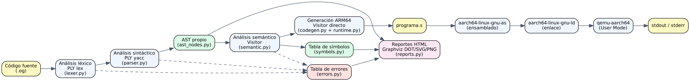
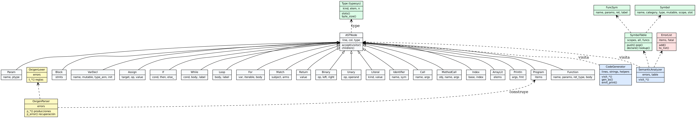

# OxigenNative — Documentación Técnica

**Curso:** Organización de Lenguajes y Compiladores 2 · USAC · 2S2026
**Proyecto 2:** compilador de un lenguaje inspirado en Rust que genera código **ARM64 (AArch64)** y lo ejecuta con **QEMU User Mode**.

## 1. Arquitectura

Aplicación monolítica cliente/servidor:

| Capa | Tecnología | Archivos |
|---|---|---|
| Presentación | HTML/CSS/JS (editor con numeración de líneas, consola, pestañas de reportes) | `webapp/templates`, `webapp/static` |
| Servicios | Django + API REST JSON (`/api/compile`) | `webapp/views.py`, `webapp/urls.py` |
| Lenguaje | PLY (lex + yacc), AST propio, Visitor | `compiler/lexer.py`, `parser.py`, `ast_nodes.py` |
| Análisis y generación | Semántico + generación directa a ARM64 | `compiler/semantic.py`, `codegen.py`, `runtime.py` |
| Ejecución | `aarch64-linux-gnu-as`, `aarch64-linux-gnu-ld`, `qemu-aarch64` | `compiler/toolchain.py` |



### 1.1 Diagrama de clases



### 1.2 Estructura de carpetas

```
OLC2_P2_2S2026/
├── manage.py, oxigennative/      # proyecto Django (settings, urls)
├── webapp/                       # app Django: vistas API + GUI
├── compiler/
│   ├── lexer.py                  # análisis léxico (PLY)
│   ├── parser.py                 # gramática + construcción del AST + recuperación de errores
│   ├── ast_nodes.py              # clases del AST (patrón Visitor)
│   ├── typesys.py                # sistema de tipos
│   ├── symbols.py                # tabla de símbolos con ámbitos
│   ├── semantic.py               # análisis semántico
│   ├── codegen.py                # generación de ARM64 (Visitor)
│   ├── runtime.py                # runtime en ensamblador (E/S, heap, strings, f64)
│   ├── toolchain.py              # ensamblar, enlazar, ejecutar con QEMU
│   ├── reports.py                # errores/símbolos HTML, AST con Graphviz
│   └── driver.py                 # pipeline completo
└── docs/                         # esta documentación y el manual de usuario
```

## 2. Gramática formal de OxigenNative

Notación EBNF. Los terminales en mayúsculas son tokens producidos por PLY.

```ebnf
program      ::= { function | var_decl }
function     ::= "fn" ID "(" [ params ] ")" [ "->" type ] block
params       ::= param { "," param } [ "," ]
param        ::= ID ":" type

type         ::= "i32" | "f64" | "bool" | "char" | "String" | "str" | "&" "str"
               | "[" type ";" INT "]"            (* arreglo, anidable: N dimensiones *)
               | "Vec" "<" type ">"

block        ::= "{" { stmt } "}"
stmt         ::= var_decl | assign ";" | expr ";" | if_stmt | while_stmt | loop_stmt
               | for_stmt | match_stmt | block
               | "break" [ LABEL ] ";" | "continue" [ LABEL ] ";" | "return" [ expr ] ";"

var_decl     ::= ( "let" | "let" "mut" ) ID [ ":" type ] [ "=" expr ] ";"
assign       ::= expr ( "=" | "+=" | "-=" | "*=" | "/=" | "%=" ) expr   (* izquierda: ID o índice *)

if_stmt      ::= "if" expr block [ "else" ( block | if_stmt ) ]
while_stmt   ::= [ LABEL ":" ] "while" expr block
loop_stmt    ::= [ LABEL ":" ] "loop" block
for_stmt     ::= [ LABEL ":" ] "for" ID "in" expr block        (* expr: rango a..b, a..=b o arreglo *)
match_stmt   ::= "match" expr "{" arm { arm } "}"
arm          ::= pattern { "|" pattern } "=>" ( block | stmt_sin_punto_y_coma ) [ "," ]
pattern      ::= "_" | expr                                    (* literal o rango literal *)

expr         ::= expr ( "||" | "&&" | "==" | "!=" | "<" | "<=" | ">" | ">="
                      | "+" | "-" | "*" | "/" | "%" ) expr
               | expr ( ".." | "..=" ) expr | expr "as" type
               | ( "-" | "!" | "&" ) expr | postfix
postfix      ::= primary { "[" expr "]" | "." ID "(" [ args ] ")" }
primary      ::= INT | FLOAT | STRING | CHAR | "true" | "false" | ID | ID "(" [ args ] ")"
               | "(" expr ")" | "[" [ args ] "]" | "[" expr ";" INT "]"
               | "String" "::" ID "(" [ args ] ")" | ( "println!" | "print!" ) "(" [ args ] ")"
```

Precedencia (de menor a mayor): `..`, `||`, `&&`, `== !=`, `< <= > >=`, `+ -`, `* / %`, `as`, unarios (`- ! &`).

Léxico: identificadores `(letra|_)(letra|dígito|_)*` (sensibles a mayúsculas); comentarios `//…` y `/*…*/` (descartados); cadenas con escapes (`\n \t \" \\ \u{..}`) y raw strings `r"…"` / `r#"…"#`; etiquetas `'nombre`.

## 3. Análisis semántico

El `SemanticAnalyzer` es un Visitor que anota cada nodo con su tipo y símbolo. Verifica: declaración antes de uso, ámbitos anidados con *shadowing*, mutabilidad (`let` vs `let mut`), compatibilidad de tipos en asignaciones/argumentos/retornos, tablas de tipos de los operadores (suma, resta, multiplicación, división, módulo, igualdad y relacionales según la especificación), `i32 → f64` por promoción, conteo y tipos de argumentos, límites de índices constantes y de slices, `break/continue/return` válidos, `match` con comodín `_`, condiciones `bool`, y que todos los caminos de una función con tipo de retorno terminen en `return`.

**Resiliencia.** Un error no detiene el análisis: la expresión errónea recibe el tipo especial `none`, no genera errores en cascada y, al imprimirse, muestra `None` (p. ej. `a + nombre` con `i32 + String`). La asignación a una variable inmutable simplemente se omite. Sólo impiden ejecutar los errores *críticos*: errores sintácticos no recuperables y la ausencia de `main`.

## 4. Manejo de errores

Se reportan tres categorías (Léxico, Sintáctico, Semántico) con tipo, descripción, línea, columna y fragmento:

```
[Error Semántico] Línea 6, Columna 24
No es posible aplicar el operador '+' entre los tipos i32 y String.
```

* **Léxicos:** carácter desconocido, cadena/comentario sin cerrar, escape inválido; el lexer descarta el carácter y continúa.
* **Sintácticos:** `p_error` calcula los tokens *esperados* por el autómata LALR (`parser.action[state]`). Si falta `;`, `)`, `]` o `}` se **inserta** el token (`parser.errok()` + devolver token sintético), se registra "Se esperaba ';'" justo después del token previo y el parsing continúa — el programa se compila y ejecuta igualmente. Otros errores usan recuperación por pánico (`stmt : error ";"`) y son críticos.
* **Semánticos:** ver sección 3.

## 5. Generación de código de bajo nivel (ARM64)

El `CodeGenerator` recorre el AST y emite **directamente** instrucciones AArch64 (sin código de tres direcciones).

### 5.1 Modelo de memoria

* **Stack:** cada función reserva su frame con `stp x29, x30, [sp, #-N]!` + `mov x29, sp`; las variables locales y parámetros son celdas de 8 bytes en `[x29, #16 + 8·i]`; el epílogo restaura con `ldp` y `ret`. `sp` permanece alineado a 16 bytes (los temporales se apilan con `str x0, [sp, #-16]!`).
* **Heap:** asignador *bump* sobre una región `.bss` de 128 MB (`_alloc`). Allí viven **cadenas** (NUL-terminadas) y **arreglos**. Un `Vec<&str>` (resultado de `split`) guarda su longitud en `[ptr-8]`.
* **Globales:** etiquetas en `.data`, inicializadas por `_init_globals` antes de `main`.

### 5.2 Convención de llamadas AAPCS64

Argumentos enteros/punteros en `x0–x7`, `f64` en `d0–d7`; retorno en `x0` (o `d0`); `x29` = frame pointer, `x30` = link register; `x19–x28` se preservan (las rutinas del runtime que los usan los guardan en su frame).

### 5.3 Representación de valores

| Tipo | Registro | Representación |
|---|---|---|
| `i32` | `x0` | extendido con signo a 64 bits; `sxtw` tras `add/sub/mul` emula el desbordamiento de 32 bits |
| `f64` | `d0` | doble precisión IEEE-754 (`fadd`, `fmul`, `fcmp`, `scvtf`…) |
| `bool` | `x0` | 0 / 1 |
| `char` | `x0` | punto de código Unicode (se imprime en UTF-8) |
| `String` | `x0` | puntero a bytes UTF-8 terminados en NUL |
| `[T; N]`, slice | `x0` | puntero al bloque contiguo (slice = vista con desplazamiento, sin copiar) |

### 5.4 Arreglos multidimensionales: **Row-Major**

Se eligió **orden por filas (row-major)** — el estándar de C, C++ y Rust — porque coincide con el orden natural de los literales `[[1,2,3],[4,5,6]]` (se pueden volcar secuencialmente al heap) y porque `a[i][j]` se reduce a aritmética de punteros sin transponer: para `[[i32; C]; F]`, `offset = (i·C + j)·8`. Cada nivel de indexación calcula `dirección = base + i·tamaño_del_elemento` (el tamaño de un sub-arreglo es `N·…` celdas), lo que generaliza a 3D y N dimensiones. Todo acceso lleva comprobación de límites (`cmp` + `b.hs _panic_oob`); los índices constantes fuera de rango se reportan en compilación.

### 5.5 Traducción de las construcciones

| OxigenNative | ARM64 |
|---|---|
| `a + b` (i32) | `add x0, x1, x0` + `sxtw x0, w0` |
| `a / b`, `a % b` | verificación `cbz x0, _panic_div0`; `sdiv`, `msub` |
| `a < b` | `cmp x1, x0` + `cset x0, lt` (f64: `fcmp` + `cset mi`) |
| `a && b`, `a \|\| b` | cortocircuito con `cbz` / `cbnz` y etiquetas |
| `if / while / loop / for / match` | etiquetas `.Lwhile1`, `.Lendif2`…, saltos `b`, `b.cond`, `cbz` |
| `break 'etiqueta` | pila de contextos de ciclo → `b` a la etiqueta de salida del ciclo indicado |
| llamada `f(a, b)` | evaluación a la pila → carga a `x0–x7`/`d0–d7` → `bl fn_f` |
| `String + String`, `*`, `==` | `_str_concat`, `_str_repeat`, `_str_cmp` |
| `println!("{}", x)` | `_out_write` para el texto literal y `_print_int / _print_f64 / _print_str…` según el tipo estático |

### 5.6 Ejemplo entrada → salida

Entrada:

```rust
fn sumar(a: i32, b: i32) -> i32 {
    return a + b;
}

fn main() {
    let mut x: i32 = 10;
    if x < 20 {
        x = sumar(x, 5);
    }
    println!("x = {}", x);
}
```

Salida ARM64 (extracto real del compilador):

```asm
// ---- fn sumar(a: i32, b: i32) -> i32  [parámetros: x0-x7 / d0-d7, retorno: x0 / d0] ----
fn_sumar:
    // prólogo: reserva stack frame de 32 bytes (x29=frame pointer, x30=link register)
    stp  x29, x30, [sp, #-32]!
    mov  x29, sp
    str  x0, [x29, #16]
    str  x1, [x29, #24]
    // return a + b
    ldr  x0, [x29, #16]
    str  x0, [sp, #-16]!
    ldr  x0, [x29, #24]
    ldr  x1, [sp], #16
    add  x0, x1, x0
    sxtw x0, w0
    b    .Lret_sumar
.Lret_sumar:
    // epílogo: restaura registros y retorna
    ldp  x29, x30, [sp], #32
    ret

// ---- fn main()  [parámetros: x0-x7 / d0-d7, retorno: x0 / d0] ----
.global main
main:
    // prólogo: reserva stack frame de 32 bytes (x29=frame pointer, x30=link register)
    stp  x29, x30, [sp, #-32]!
    mov  x29, sp
    // let mut x: i32 = 10;
    mov  x0, #10
    str  x0, [x29, #16]
    // if x < 20 { ... }
    ldr  x0, [x29, #16]
    str  x0, [sp, #-16]!
    mov  x0, #20
    ldr  x1, [sp], #16
    cmp  x1, x0
    cset x0, lt
    cbz  x0, .Lendif1
    // x = sumar(x, 5);
    ldr  x0, [x29, #16]
    str  x0, [sp, #-16]!
    mov  x0, #5
    str  x0, [sp, #-16]!
    ldr  x0, [sp, #16]
    ldr  x1, [sp, #0]
    add  sp, sp, #32
    bl   fn_sumar
    str  x0, [x29, #16]
.Lendif1:
    // println!(...);
    // println! ...
    adrp x0, .LS0
    add  x0, x0, :lo12:.LS0
    mov  x1, #4
    bl   _out_write
    ldr  x0, [x29, #16]
    bl   _print_int
    bl   _print_nl
.Lret_main:
    ...
```

### 5.7 Runtime (`runtime.py`)

Escrito en ensamblador, sin libc; sólo usa las llamadas al sistema `write`, `exit` y `getrandom`. Sólo se incluyen las rutinas que el programa necesita (cierre transitivo de dependencias): salida con buffer (`_out_write`, `_flush`), impresión de `i32`, `f64` (representación decimal **más corta que reproduce el valor**, como `Display` de Rust; `{:.N}` con redondeo), `bool`, `char` (UTF-8) y cadenas; `_alloc`; `_memcpy`; operaciones de cadenas (`concat`, `repeat`, `cmp`, `find`, `replace`, `upper/lower`, `split`, `split_whitespace`); `_arr_reverse`; `_random` (xorshift64 sembrado con `getrandom`); `_panic` (stderr, código 101).

## 6. Decisiones de diseño y desafíos

* **Sin IR:** el Visitor emite ARM64 directamente; los temporales viven en la pila, lo que simplifica la correctitud a costa de código poco optimizado.
* **Tipos estáticos en la impresión:** `typeof(x)` se resuelve en compilación; `println!` despacha por tipo estático y genera impresores específicos para arreglos (`_pa_N`, recursivos para N dimensiones).
* **Tipo `none`** para continuar tras errores semánticos (ver §3) y que la salida muestre `None`.
* **Recuperación sintáctica por inserción de tokens** usando la tabla LALR, en lugar de sólo modo pánico, para ejecutar programas con un `;` olvidado.
* **Slices** como vistas (puntero + longitud estática en el tipo), sin copiar datos; **Vec** dinámico sólo como resultado de `split`/`split_whitespace`.
* **Mutabilidad de elementos:** el ejemplo oficial modifica `matrix[1][2]` sobre un `let` inmutable; por ello se permite asignar a *elementos* de un arreglo aunque la variable no sea `mut` (la variable en sí sigue siendo inmutable). `reverse()` y `push_str()` sí exigen `mut`.
* **Paréntesis en condiciones:** se reporta un error sintáctico no crítico (la especificación no los permite) y se continúa.
* **Desafío — `f64`:** imprimir el decimal más corto sin libc. Se prueba cada cantidad de decimales *n* hasta que `round(x·10ⁿ)/10ⁿ == x`.

## 7. Limitaciones conocidas

* Genéricos, traits y métodos `impl` no están soportados.
* **Structs** (soportados): `struct Nombre { campo: tipo, ... }`, literal `Nombre { campo: expr, ... }` (anidable),
  acceso `a.b.c` y asignación a campos (`p.x = 3;`, `p.x += 1;`, requiere `let mut`).
  Gramática añadida: `struct_decl : STRUCT STRUCT_NAME LBRACE params RBRACE`, `primary : STRUCT_NAME LBRACE field_inits RBRACE`,
  `postfix : postfix DOT ID`, `type : ID`. El lexer emite `STRUCT_NAME` sólo cuando un identificador en mayúscula va
  seguido de `{ campo:` o `{ }`, lo que evita confundir el literal con el bloque de `if`/`while`.
  Generación ARM64: un struct es un bloque contiguo en el heap con una celda de 8 bytes por campo escalar;
  los structs anidados se aplanan dentro del bloque (igual que los arreglos multidimensionales). El valor de una
  variable/parámetro struct es un puntero; `a.b` calcula `base + offset` y hace `ldr`/`str`.
* Ámbitos en la tabla de símbolos: `Global`, nombre de función, `if (fn)`, `else (fn)`, `while`, `loop`, `for`.
* `f64`: en valores con 17 cifras significativas la última cifra puede diferir del algoritmo exacto de Rust (p. ej. `10.0/3.0`); valores ≥ 2⁶³ o < 10⁻¹⁷ no se imprimen con exactitud.
* `to_uppercase/to_lowercase` sólo transforman ASCII; `len()` cuenta bytes UTF-8 (igual que Rust).
* `random(min, max)` incluye ambos extremos.
* Las cadenas no pueden contener el carácter NUL.

## 8. Pruebas

`python3 tests/run_tests.py` compila y ejecuta cada programa de `tests/examples/*.og` y compara su salida con `*.expected` (17 casos: identificadores, comentarios, tipos, mutabilidad, aritmética, relacionales/lógicos, control de flujo, arreglos 1D/2D/3D, strings, funciones, builtins, errores léxicos/sintácticos/semánticos, globales y pánicos).
