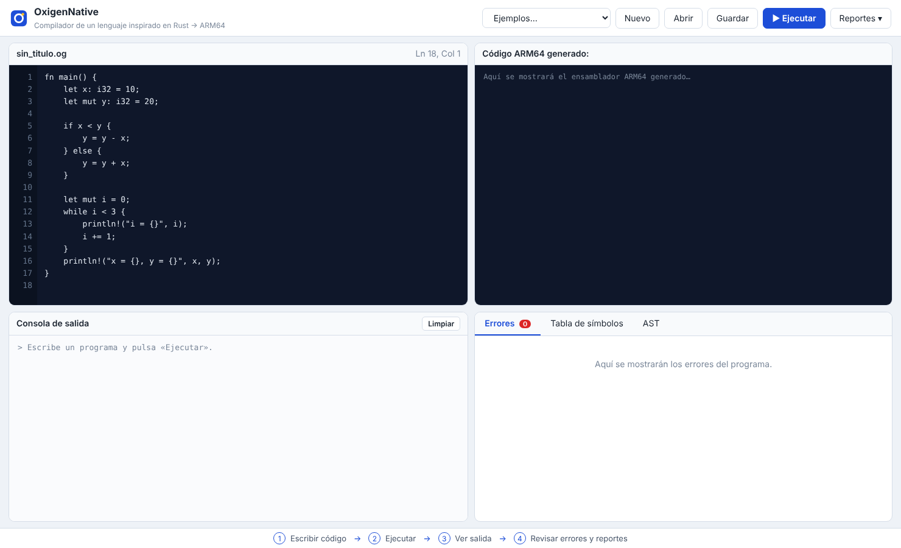
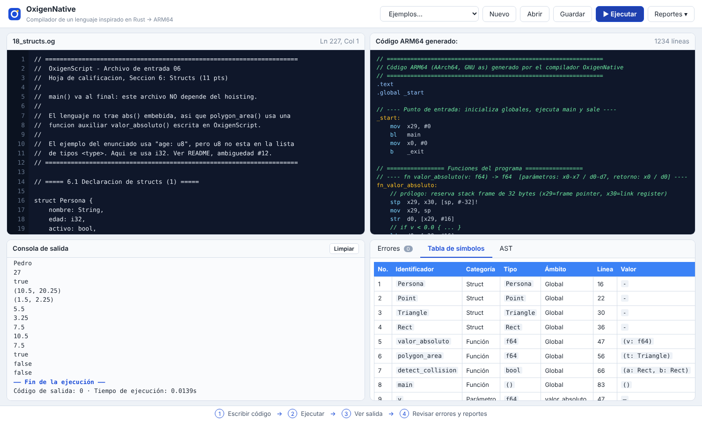
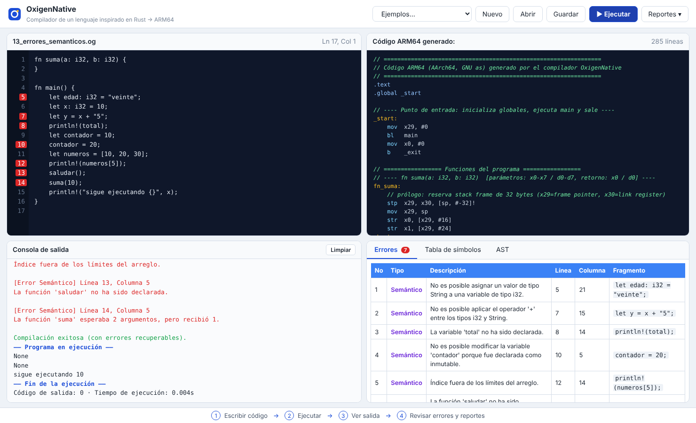
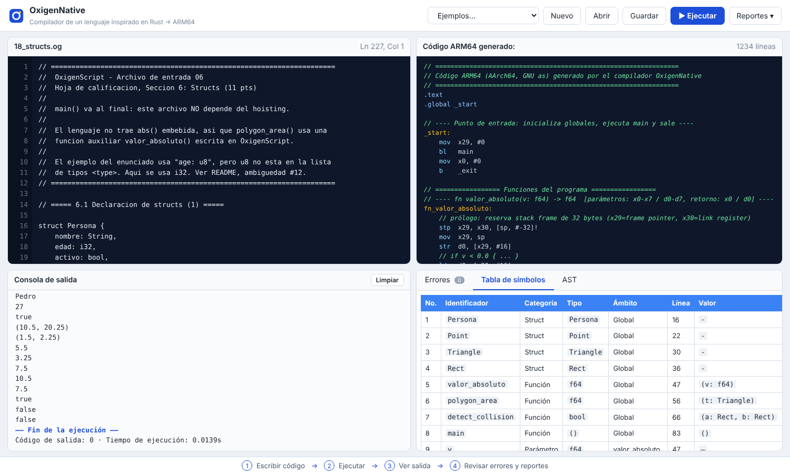
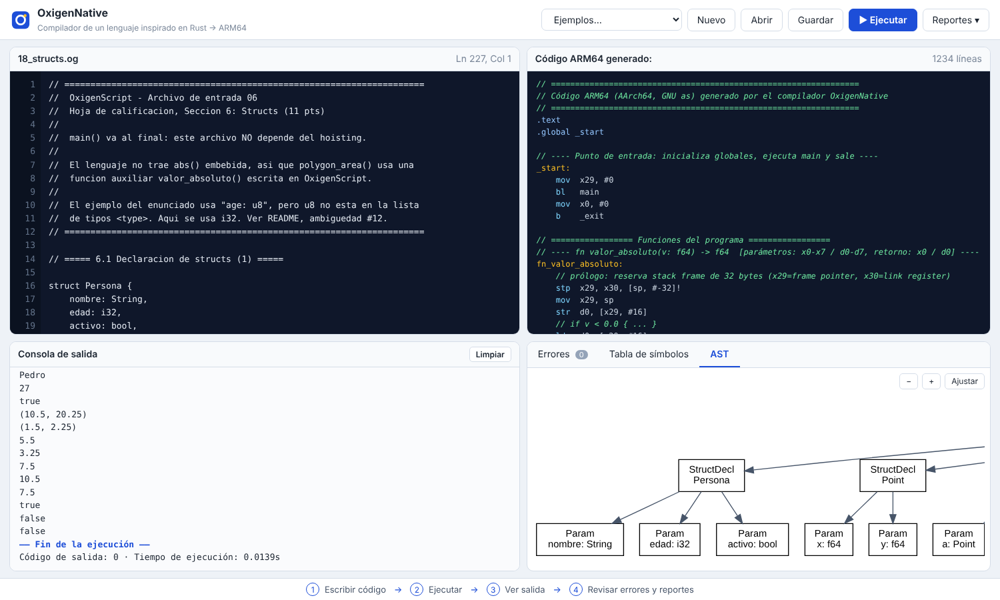
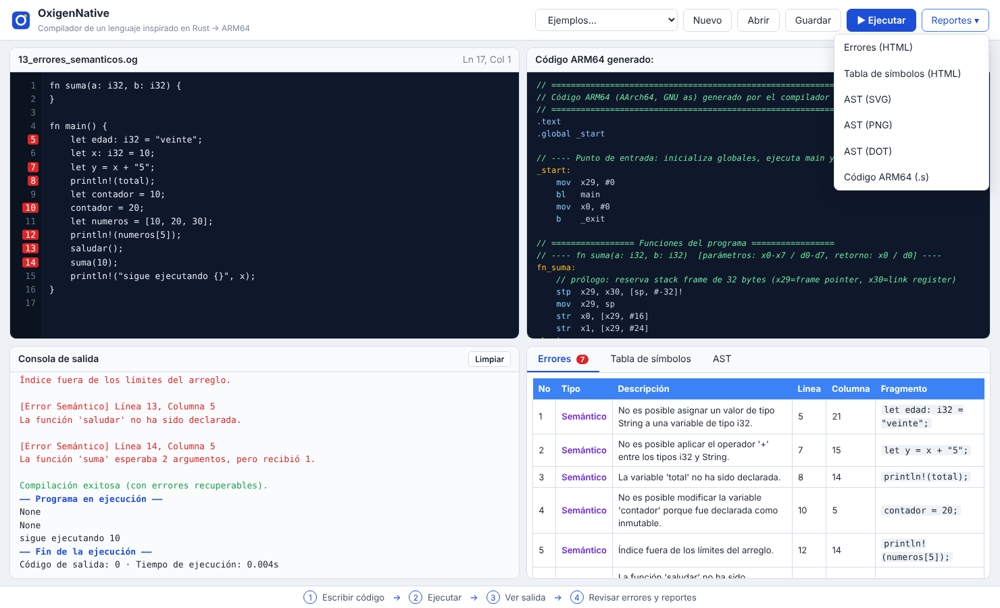

# OxigenNative — Manual de Usuario

## 1. Requisitos e instalación

Sistema operativo **Linux** (probado en Ubuntu/Debian) con:

| Herramienta | Paquete (apt) |
|---|---|
| Python 3.10+ | `python3`, `python3-pip` |
| Ensamblador y enlazador ARM64 | `binutils-aarch64-linux-gnu` |
| Emulador | `qemu-user` |
| Graphviz (reporte del AST) | `graphviz` |

```bash
sudo apt install python3 python3-pip binutils-aarch64-linux-gnu qemu-user graphviz
cd OLC2_[Seccion]_P2_2S2026
pip install -r requirements.txt          # ply, django
python3 manage.py runserver              # abre http://127.0.0.1:8000
```

> En un equipo ARM64 nativo no se necesita QEMU: el ejecutable se corre directamente.

## 2. La interfaz



1. **Barra de herramientas:** *Ejemplos* (carga programas de prueba), *Nuevo*, *Abrir* (carga un archivo `.og` de su equipo), *Guardar* (descarga el código), *Ejecutar* (`Ctrl + Enter`) y *Reportes*.
2. **Editor de código** (arriba izquierda) con numeración de líneas y posición del cursor. Tras ejecutar, las líneas con error se marcan en rojo.
3. **Código ARM64 generado** (arriba derecha): es exactamente el ensamblador que se enlaza y ejecuta en QEMU.
4. **Consola de salida** (abajo izquierda): errores, mensajes de estado, salida del programa, código de salida y tiempo de ejecución.
5. **Panel de reportes** (abajo derecha): pestañas *Errores*, *Tabla de símbolos* y *AST*.

## 3. Crear, editar y ejecutar código

1. Escriba un programa (o elija uno en *Ejemplos*). Todo programa necesita una función `main`:

```rust
fn main() {
    let nombre = String::from("Ana");
    let mut total: i32 = 0;
    for i in 1..=5 {
        total += i;
    }
    println!("Hola {}, la suma es {}", nombre, total);
}
```

2. Pulse ** Ejecutar**. El servidor analiza (léxico, sintáctico, semántico), genera ARM64, lo ensambla, enlaza y ejecuta con QEMU.



3. Revise la consola: verá `Compilación exitosa`, la salida del programa y el tiempo de ejecución. Si el programa tiene un ciclo infinito, se detiene a los 10 s.

### Resumen del lenguaje

| Elemento | Ejemplo |
|---|---|
| Variables | `let x = 5;` · `let mut y: f64 = 2.5;` (inmutables por defecto) |
| Tipos | `i32 f64 bool char String [T; N]` (arreglos multidimensionales `[[i32; 3]; 2]`) |
| Operadores | `+ - * / %`, `== != < <= > >=`, `&& \|\| !`, `+= -= *= /= %=` |
| Control | `if / else if / else`, `while`, `loop`, `for i in 0..n`, `match`, `break`, `continue` (con etiquetas `'a:`) |
| Funciones | `fn suma(a: i32, b: i32) -> i32 { return a + b; }` |
| Arreglos | `let a = [1, 2, 3]; a[0]; a.len(); &a[0..2]` |
| Cadenas | `String::from("..")`, `+`, `*`, `len() contains() replace() split() to_uppercase() to_lowercase()` |
| Structs | `struct Point { x: f64, y: f64 }` · `let p = Point { x: 1.0, y: 2.0 };` · `p.x` · `p.x = 3.0;` (con `let mut`) · anidados: `r.pos.x` |
| Salida | `println!("x = {}", x);` · `{:?}` (arreglos) · `{:.2}` (decimales) |
| Otras | `typeof(x)`, `random(min, max)` |

## 4. Interpretar los reportes

### 4.1 Errores
Muestra tipo (**Léxico**, **Sintáctico**, **Semántico**), descripción, línea, columna y el fragmento de código. Un error no detiene la compilación salvo que sea crítico (por ejemplo, falta `main` o un error sintáctico no recuperable); las expresiones erróneas se imprimen como `None`.



### 4.2 Tabla de símbolos

Lista variables, parámetros, funciones y structs (categoría `Struct`). Los ámbitos se muestran como `Global`, el nombre de la función, `if (main)`, `else (main)`, `while`, `loop` o `for`.

Lista cada variable, parámetro y función con su categoría, tipo, ámbito (`Global`, nombre de la función o bloque), línea y valor (constante calculada o la expresión inicial).



### 4.3 AST
Árbol de sintaxis abstracta dibujado con Graphviz; use **+ / − / Ajustar** para el zoom.



### 4.4 Descargas
El menú **Reportes** descarga/abre: `errores.html`, `simbolos.html`, `ast.svg`, `ast.png`, `ast.dot` y el `programa.s` generado. Los archivos de la última ejecución también quedan en la carpeta `reports/ultima_ejecucion/`.



## 5. Ejemplo de sesión con errores

```rust
fn main() {
    let edad = 20;
    edad = 21;                 // error: variable inmutable
    let total = edad + "5";    // error: tipos incompatibles
    println!("{}", total);     // imprime None
    println!("sigue");         // el programa continúa
}
```

La consola mostrará los errores semánticos con su línea/columna y, a continuación, la salida `None` y `sigue`.

## 6. Pruebas desde la terminal

```bash
python3 tests/run_tests.py      # ejecuta los 17 programas de tests/examples y compara salidas
```

## 7. Solución de problemas

| Síntoma | Causa / solución |
|---|---|
| «Faltan herramientas: aarch64-linux-gnu-as…» | instalar `binutils-aarch64-linux-gnu` y `qemu-user` |
| AST sin imagen | instalar `graphviz` (`dot` en el PATH) |
| «Tiempo de ejecución excedido» | el programa tiene un ciclo infinito o es muy lento |
| `panic: índice fuera de los límites` | acceso a un arreglo fuera de rango en tiempo de ejecución (código de salida 101) |
